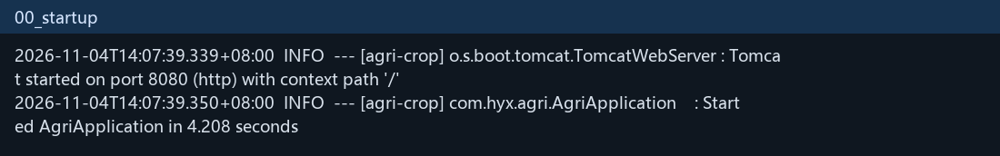
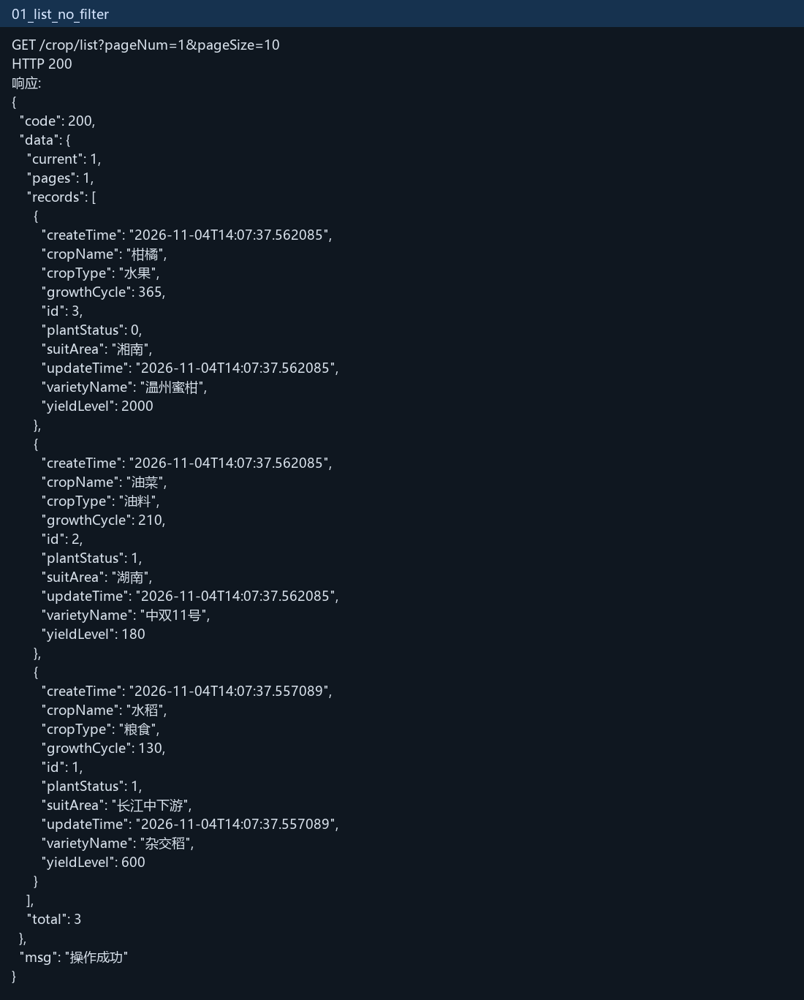
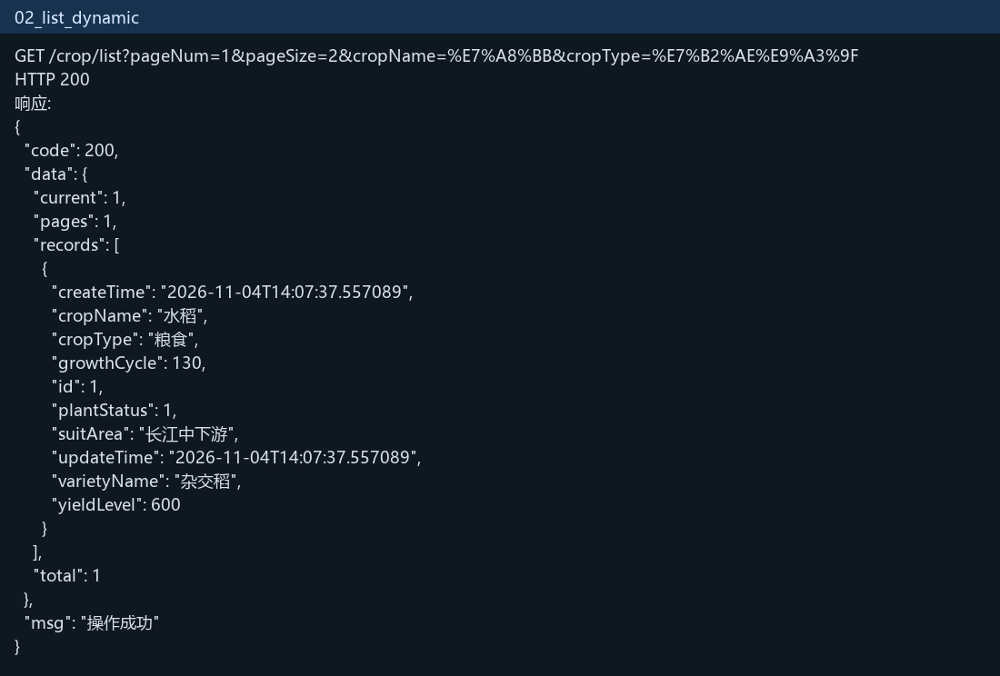
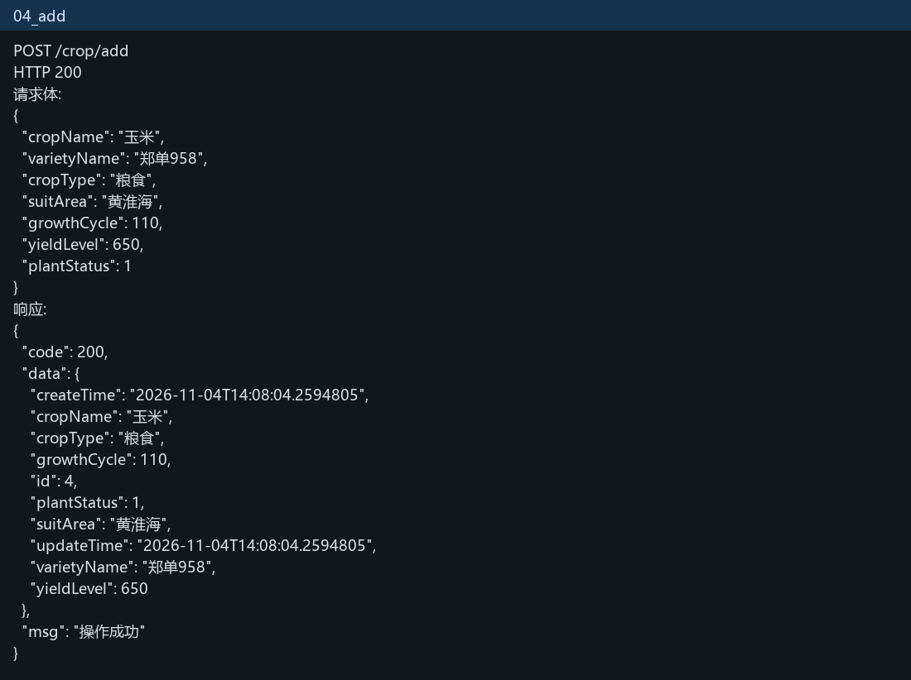
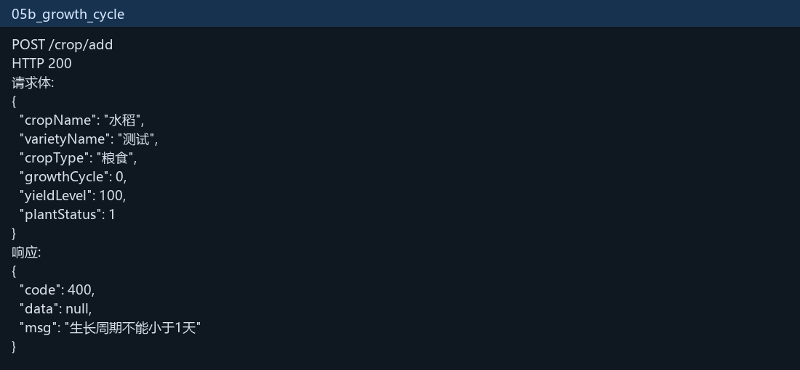
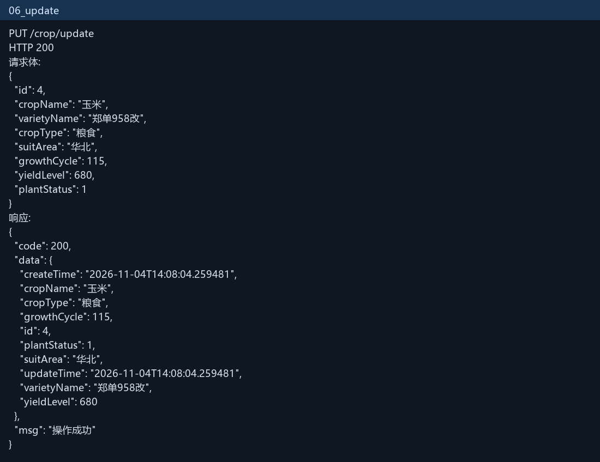
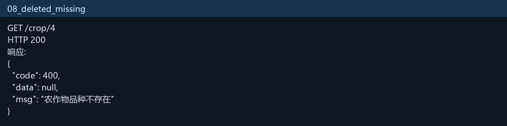

# 农作物品种信息管理

选项 A。用 Spring Boot 和 MyBatis-Plus 做农作物品种的新增、修改、查询、逻辑删除和分页动态查询。

## 技术栈版本

- JDK 21
- Spring Boot 4.1.2
- MyBatis-Plus 3.5.18.1（`mybatis-plus-spring-boot4-starter`）
- Maven 3.10.0
- 数据库：H2 内存库，方便直接启动。表结构在 `schema.sql`，初始数据在 `data.sql`

## 环境与启动

安装 JDK 21 和 Maven 后，在项目根目录执行：

```bash
mvn spring-boot:run
```

启动成功后访问 `http://127.0.0.1:8080`。本机实测 Tomcat 监听 8080，应用在 4.2 秒内启动。



## 包结构

根包是 `com.hyx.agri`。

```text
com.hyx.agri
├── AgriApplication.java
├── config
│   ├── MybatisPlusConfig.java
│   └── MyMetaObjectHandler.java
├── entity
│   └── Crop.java
├── dto
│   └── CropDTO.java
├── vo
│   └── CropVO.java
├── mapper
│   └── CropMapper.java
├── service
│   ├── CropService.java
│   └── impl
│       └── CropServiceImpl.java
├── controller
│   └── CropController.java
├── exception
│   ├── BusinessException.java
│   └── GlobalExceptionHandler.java
└── common
    ├── Result.java
    └── PageResult.java
```

## Entity、DTO、VO

- Entity `Crop` 对应表 `crop`。主键自增，`createTime`、`updateTime` 由 `MyMetaObjectHandler` 自动填充。`deleted` 使用 `@TableLogic`，删除时只把该字段改成 1。Entity 不写校验，也不直接返回给前端。
- DTO `CropDTO` 接收新增和修改。作物名称、品种名称、作物类型非空且限制长度；生长周期为 1 到 3650 天；亩产不能为负数；推广状态只能是 0 或 1。
- VO `CropVO` 只放展示字段。逻辑删除标记 `deleted` 不出现在返回结果里。

## 接口

统一返回：

```json
{ "code": 200, "msg": "操作成功", "data": {} }
```

| 接口 | 方法 | 路径 | 说明 |
| --- | --- | --- | --- |
| 新增 | POST | `/crop/add` | 请求体为 CropDTO |
| 修改 | PUT | `/crop/update` | 请求体为 CropDTO，必须带 id |
| 按 id 查询 | GET | `/crop/{id}` | 返回 CropVO |
| 删除 | DELETE | `/crop/{id}` | 逻辑删除 |
| 分页动态查询 | GET | `/crop/list` | pageNum、pageSize、cropName、varietyName、cropType、plantStatus |

分页结果放在 `data` 里，包含 `total`、`pages`、`current`、`records`。

## 关键实现

动态查询用 `LambdaQueryWrapper`。某个条件没传或是空白，就不拼进 SQL。作物名称、品种名称用 `like`，作物类型和推广状态用 `eq`。

分页插件在 `MybatisPlusConfig` 里注册，数据库类型是 H2。

`GlobalExceptionHandler` 捕获校验异常、业务异常和未知异常。校验失败返回 `code=400` 和字段上的提示。查不到或删除后再查，返回“农作物品种不存在”。未知异常打 error 日志并返回 500。

日志用 SLF4J。Controller 打印入参和出参，Service 打印关键步骤，异常带堆栈。没有使用 `System.out`。

## 测试记录

下面的图是本机对正在运行的服务发请求后记下的结果。

不传查询条件，三条初始数据都返回：



只按作物名称“稻”和类型“粮食”查询，只剩水稻：



按 id 查询：


新增玉米：



生长周期传 0，校验失败：



修改后再逻辑删除。删除后用同一个 id 查询，提示品种不存在：





